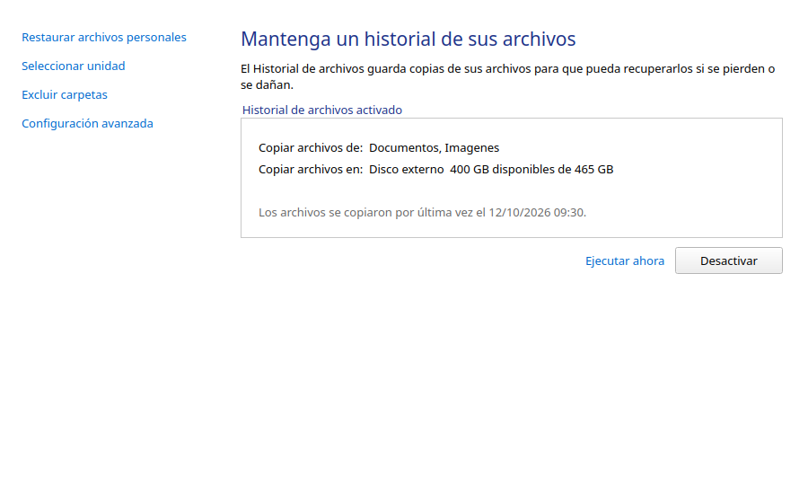
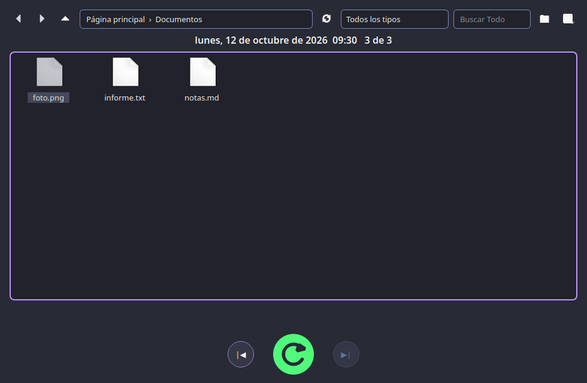
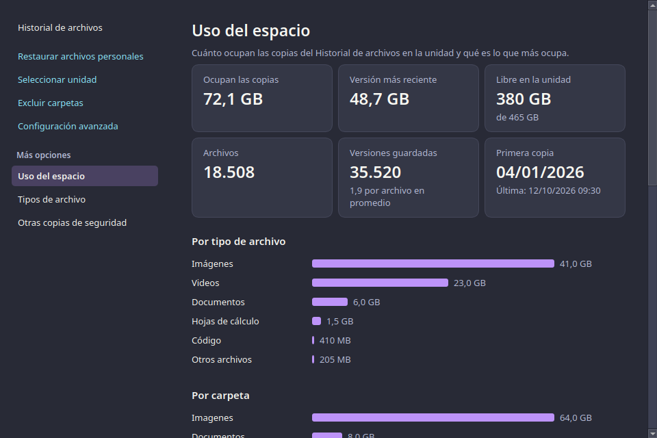
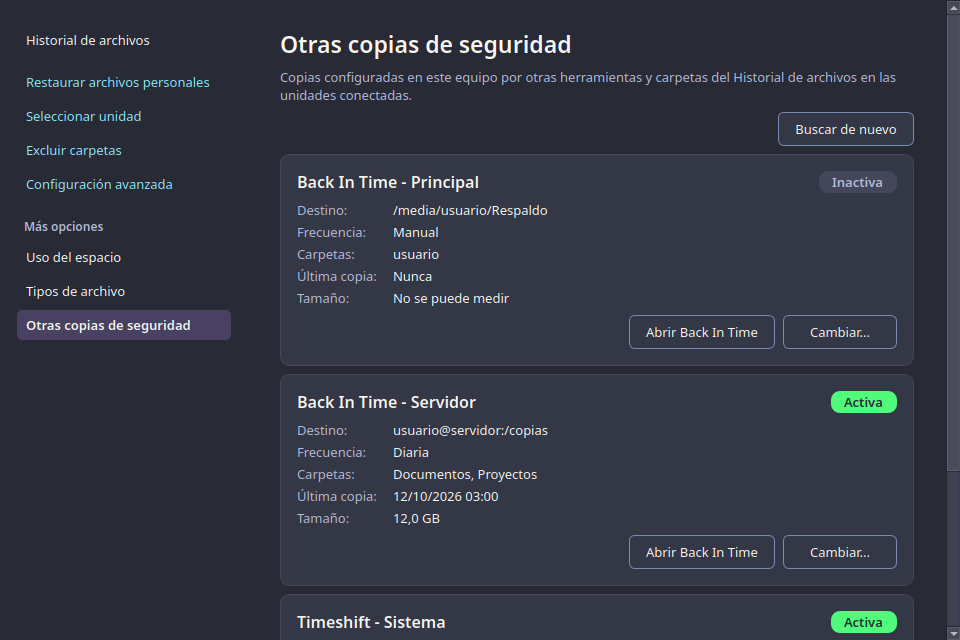

# Historial de archivos

[Español](#español) | [English](#english)

## Español

Historial de archivos al estilo de Windows para Linux y macOS. Guarda versiones de tus
carpetas personales en una unidad externa, local o de red, y las restaura desde una línea de
tiempo con los botones Anterior, Restaurar y Siguiente.

### Características

- Copia solo lo que cambió, con nombres como en Windows: `informe (2026_10_12 08_30_00 UTC).odt`.
- Catálogo SQLite, retención configurable y limpieza de versiones antiguas.
- Sin demonio residente: un temporizador de systemd de usuario (Linux) o un LaunchAgent
  (macOS) lanza la copia a la prioridad más baja y el proceso termina.
- Sin cifrar: los archivos del destino se pueden abrir con cualquier explorador.
- Interfaz Qt (PySide6, o PyQt6 como alternativa) con las mismas páginas del Panel de control
  de Windows: Seleccionar unidad, Excluir carpetas, Configuración avanzada, Restaurar archivos
  personales y Versiones anteriores.
- Tema Drácula (por defecto), Alucard claro o según el sistema, con diseño guiado por las Human Interface Guidelines de Apple.
- Uso del espacio: cuánto ocupan las copias por tipo de archivo, por carpeta y por mes, los archivos más grandes y los más versionados, y limpieza por tipo o carpeta.
- Tipos de archivo: elige qué categorías copiar (documentos, hojas de cálculo, imágenes...) y qué extensiones excluir; filtro por tipo al restaurar.
- Otras copias de seguridad: detecta Back In Time, Déjà Dup, Timeshift, Time Machine y carpetas del Historial en unidades conectadas, y permite cambiar su programación, carpetas y exclusiones.
- Menú contextual en Dolphin y Nautilus: «Versiones anteriores» y «Restaurar archivos
  personales».

### Instalación

Ubuntu y Debian (24.04 o posterior): descarga el `.deb` de la página de Releases e instala:

    sudo apt install ./historial-archivos_<versión>_all.deb

macOS: descarga el `.dmg` de tu arquitectura (`arm64` o `x86_64`) y arrastra la aplicación a
Aplicaciones. La aplicación está firmada ad hoc, sin notarizar: la primera vez, abre con clic
derecho > Abrir.

Desde el código fuente (cualquier sistema con Python 3.10 o posterior):

    pip install .          # o: pip install ".[pyqt6]" para PyQt6

### Uso

    historial-archivos                    # abre el panel
    historial-archivos --restaurar        # Restaurar archivos personales
    historial-archivos --versiones RUTA   # Versiones anteriores de un archivo o carpeta
    historial-archivos --ejecutar         # hace una copia ahora (lo usa el temporizador)
    historial-archivos --estado           # estado en JSON

### Desarrollo

    python3 -m pytest
    scripts/empaquetar-deb.sh && scripts/probar-deb.sh dist/*.deb
    scripts/empaquetar-dmg.sh             # solo en macOS

### Licencia

GPL-3.0-or-later. Ver [LICENSE](LICENSE).

## English

Windows-style File History for Linux and macOS. It keeps versions of your personal folders on
an external, local or network drive and restores them from a timeline with Previous, Restore
and Next buttons.

### Features

- Copies only what changed, named as in Windows: `report (2026_10_12 08_30_00 UTC).odt`.
- SQLite catalog, configurable retention and cleanup of old versions.
- No resident daemon: a systemd user timer (Linux) or a LaunchAgent (macOS) starts the copy at
  the lowest priority and the process exits.
- Unencrypted: the files at the destination open with any file manager.
- Qt interface (PySide6, with PyQt6 as a fallback) with the same pages as the Windows Control
  Panel: Select drive, Exclude folders, Advanced settings, Restore personal files and
  Previous versions.
- Dracula theme (default), Alucard light or follow the system, designed with Apple's Human Interface Guidelines.
- Space usage by file type, folder and month, largest and most-versioned files, cleanup by type or folder.
- File types: choose which categories to back up and which extensions to exclude; filter by type when restoring.
- Other backups: detects Back In Time, Déjà Dup, Timeshift, Time Machine and File History folders on connected drives, and lets you change their schedule, folders and exclusions.
- Dolphin and Nautilus context menu: "Previous versions" and "Restore personal files".

### Installation

Ubuntu and Debian (24.04 or later): download the `.deb` from the Releases page and install it:

    sudo apt install ./historial-archivos_<versión>_all.deb

macOS: download the `.dmg` for your architecture (`arm64` or `x86_64`) and drag the app to
Applications. The app is ad hoc signed, not notarized: the first time, right-click > Open.

From source (any system with Python 3.10 or later):

    pip install .          # or: pip install ".[pyqt6]" for PyQt6

### Usage

    historial-archivos                    # open the panel
    historial-archivos --restaurar        # Restore personal files
    historial-archivos --versiones PATH   # Previous versions of a file or folder
    historial-archivos --ejecutar         # run a copy now (used by the timer)
    historial-archivos --estado           # status as JSON

### Development

    python3 -m pytest
    scripts/empaquetar-deb.sh && scripts/probar-deb.sh dist/*.deb
    scripts/empaquetar-dmg.sh             # macOS only

### License

GPL-3.0-or-later. See [LICENSE](LICENSE).
